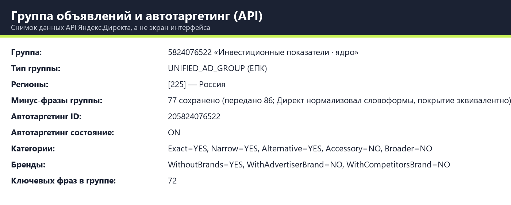
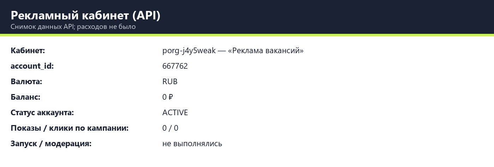

# Finindi — материалы подготовки РСЯ (Яндекс.Директ) + сопутствующий пакет VK Ads

Дата: **18.11.2026**. Кампания Яндекс.Директа **716189770** (`invest-guide-EPK-RSYa`) подготовлена и оставлена в **DRAFT / OFF**. Кампания **не запускалась**, модерация не отправлялась, расходов нет (баланс кабинета 0 ₽).

Это единая точка входа: финальный аудит, сверка семантики (Excel), отчёт, ключевые фразы, 5 креативов, снимки данных API, сырые ответы API (evidence) и ранее подготовленный пакет VK Ads.

## Что открыть в первую очередь

| Материал | Файл |
|---|---|
| **Финальная проверка кампании: параметры, статусы, блокеры** | [13_FINAL_AUDIT_2026-11-18.md](13_FINAL_AUDIT_2026-11-18.md) |
| **Сверка семантики: Исходник / Сравнение / Активные ключи / Минус-фразы / Исключения / Рекомендации** | [keywords_compare.xlsx](keywords_compare.xlsx) |
| **Полный отчёт по подготовке РК** | [ОТЧЁТ-РСЯ-716189770-2026-11-18.md](ОТЧЁТ-РСЯ-716189770-2026-11-18.md) |
| **Итоговая таблица параметров (снимок)** | [screenshots/07_params_table.png](screenshots/07_params_table.png) |
| **Ключевые фразы — лист `Keywords`, 284 строки** | [keywords_RSYA.xlsx](keywords_RSYA.xlsx) |
| **Креативы (5 PNG третьей редакции + описание)** | [creatives_RSYA/](creatives_RSYA/) |
| **Финальные чтения API после всех действий** | [final_api/](final_api/) |
| **Сырые ответы API (вся доказательная база)** | [evidence_api/](evidence_api/) |
| **Пакет VK Ads (в этой сессии не проверялся)** | [related_vk_ads/](related_vk_ads/) |

## Ключевые факты

| Параметр | Значение |
|---|---|
| Кампания | 716189770, UNIFIED (ЕПК), **DRAFT / OFF**, показов 0, кликов 0 |
| Стратегия | **«Максимум конверсий с оплатой за клики»** (`WB_MAXIMUM_CONVERSION_RATE`) |
| Цель оптимизации | **`purchase` 683156691** (в настройках; фактическое срабатывание не проверено) |
| Бюджет | недельный лимит **5 250 ₽** (эквивалент 750 ₽/день) |
| Общий бюджет 10 500 ₽ / 14 дней | требует `EndDate` при запуске — без согласованной даты не задаётся (см. финальный аудит §3) |
| Расписание | временной таргетинг в API отсутствует → по умолчанию 24/7; UI-проверка недоступна |
| Размещение | только РСЯ: Поиск `SERVING_OFF`, сеть включена |
| География | Россия (регион 225) |
| Группа | 5824076522 «Инвестиционные показатели · ядро» |
| Объявления | 2: **ГИД 490 ₽** (1927394125224178339) и **КОМПЛЕКТ 990 ₽** (1927394170321517922) |
| Ключевых фраз | 72 активных + автотаргетинг; дублей нет |
| Минус-фраз | 77 сохранено на группе, пересечений с ключами нет |
| Автотаргетинг | ON: `exact + narrow + alternative`, бренды — без брендов |
| Счётчик Метрики | 114312327 привязан к кампании (Метрика к click.ru не подключена) |
| Быстрые ссылки / уточнения | набор **1526528192** («Состав гида», «Тарифы», «Эксель-шаблон», «Вопросы и ответы») / «20+ показателей», «Формула + пример», «Гид 490 ₽», «Эксель-шаблон 990 ₽» |
| UTM | `utm_source=yandex&utm_medium=cpc&utm_campaign=finindi_rsya_invest&utm_content={ad_id}&utm_term={keyword}` — в ссылках объявлений |
| Креативы | 5 PNG третьей редакции загружены и **прикреплены к объявлениям** (3 + 3, все пять задействованы) |
| Дата старта | **13.11.2026 (в прошлом)** — API менять не умеет; правится только в UI |
| Рекламный кабинет | единственный доступный `porg-j4y5weak` «Реклама вакансий», баланс 0 ₽ — **принадлежность Finindi не подтверждена** |

## Креативы: правки владельца выполнены

Латиница — только в названиях показателей; «фининди» — только в логотипе; «Гид», «Эксель-шаблон», «промпт-пак для нейросетей»; «ПДФ» — только формат файла; на 05 — «вы видите цифры»; «8 чисел» (02) — основной.

| Файл | Хеш | Где стоит |
|---|---|---|
| 01 · 1080×607 | `FhRl1EhWcsCdL0rKDkRd_w` | ГИД 490 ₽ |
| 02 · 600×600 | `AVZN3rpsQ9WU2cOZyVmoOA` | оба объявления |
| 03 · 1080×1080 | `Eysdpx7O8OM1p22hxYqFdg` | ГИД 490 ₽ |
| 04 · 1080×1350 | `V6hLqCvQ9IglqAKmqlybvg` | КОМПЛЕКТ 990 ₽ |
| 05 · 1440×1080 | `-niEF_AZiFA5NG_VC2qX_Q` | КОМПЛЕКТ 990 ₽ |

## Скриншоты (7) — это снимки данных API, а не экраны интерфейса Директа

Браузерной сессии в кабинете Директа нет, поэтому значения зафиксированы JSON-ответами API и отрендерены в PNG. Каждый файл подписан «Снимок данных API, а не экран интерфейса».








## Структура

```
13_FINAL_AUDIT_2026-11-18.md        — финальная проверка: статусы, сверка, блокеры
keywords_compare.xlsx               — сверка семантики (6 листов)
ОТЧЁТ-РСЯ-716189770-2026-11-18.md   — полный отчёт по подготовке
keywords_RSYA.xlsx                  — лист Keywords (75 ключей + 86 минусов + 123 теста = 284)
creatives_RSYA/                     — 5 PNG + 08_creatives.md/json + source_notes + README
screenshots/                        — 7 снимков данных API
final_api/                          — финальные чтения API (кампания, объявления, ключи, изображения, уточнения)
evidence_api/                       — snapshots, raw_mcp_evidence, audit_before.json, plan.json
related_vk_ads/                     — пакет VK Ads по Finindi (в этой сессии не проверялся)
```

## Ограничения (важно для независимой проверки)

1. **UI-скриншоты Яндекс.Директа недоступны** — доступ только по API/MCP. Все значения подтверждены JSON-ответами в `evidence_api/` и `final_api/`.
2. **Исходный `keywords.xlsx` владельца не найден** — файла с листом `Keywords` нет в рабочей папке, вложениях сессии и на диске. Сверка построена по снимку API (177 ключей кампании до аудита); лист `Исходник` это явно фиксирует. Нужен файл для построчной сверки с оригиналом.
3. **Принадлежность кабинета Finindi не подтверждена** — единственный доступный кабинет `porg-j4y5weak` называется «Реклама вакансий», баланс 0 ₽; связанных кабинетов нет; Метрика к click.ru не подключена. Ничего не переносилось и не менялось.
4. **Креативы прикреплены, но состав внутри объявления API не отдаёт** — подтверждение: `AdImageHashes` в теле `ads.add`, ответы без ошибок, все 5 хешей `Associated: YES`; визуальная проверка в UI перед запуском обязательна.
5. **Дата старта в прошлом и `EndDate: null`** — API не меняет даты; при запуске в UI: `StartDate` = дата запуска, `EndDate` = +13 дней (14 календарных дней показа). До этого кампания OFF.
6. **Аудитория (7 сегментов + 5 описаний) не применена** — настройка только в UI («Интересы и привычки»), доступа к интерфейсу нет; список и ID — в финальном аудите §6 и `11_audience...md`.
7. **Цель `purchase`** принята API как GoalId; фактическое срабатывание не проверено (сайт за Basic Auth, оплат не было, Метрика не подключена к click.ru).
8. **Бюджет:** 750 ₽ × 14 дней = 10 500 ₽; недельный лимит 5 250 ₽ сам по себе не ограничивает сумму за срок — нужен `EndDate`.


---

## Обновление 18.11.2026 (вечер)

- **Исходный файл владельца найден** (`E:\DEV\Downloads\keywords.xlsx`): 194 ключа + 89 минус-фраз. В кампании из них 26 ключей и 27 минусов; 168 ключей и 62 минуса файла не загружены (аудит шёл без файла). Сверка — `keywords_compare.xlsx`, лист «Исходник» теперь из реального файла. Семантика в кампании не менялась, ждёт решения владельца.
- **Креативы v4**: убран текст «finindi» (остался только знак), убрано «ПДФ» (просто «ГИД»), в комплекте перечислены 4 файла (руководство и промпт-пак). Новые хеши: 01 `mm9gUBdyMQOOcCgAAkwEng`, 02 `Bd_Vgp7s03auRO9nMRZp9w`, 03 `eMIeSwfO-Eh3v7i7L0QW8w`, 04 `DqfALbkNf4RTcE1m3L17VA`, 05 `D2kQOj-yLcvJPK3cHztXyg`.
- **Объявления пересозданы**: 1927402082724993493 (ГИД 490 ₽), 1927402097756574232 (КОМПЛЕКТ 990 ₽); в текст комплекта добавлено «4 файла: гид, Эксель-шаблон, руководство и промпт-пак».
- **Возраст 25–45**: `0–17 = 0`, `18–24 = 0`, `55+ = 0`, `45–54 = 30 %` (группу 45–54 нельзя разделить, поэтому приглушена, а не отключена).
- **Кабинет** подтверждён владельцем (это его кабинет Finindi), баланс 0 ₽.
- **Бюджет 10 500 ₽ / 14 дней**: в Директе — «Бюджет на период» (`CustomPeriodBudget`) с датами запуска; распределяется на период и не превышается. Задаётся в UI, MCP это поле не поддерживает.
