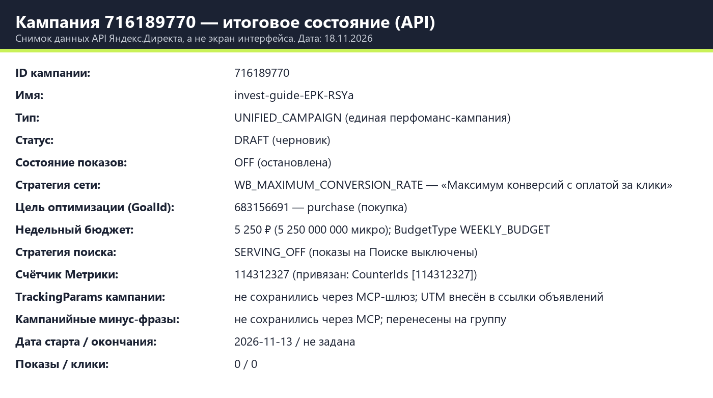
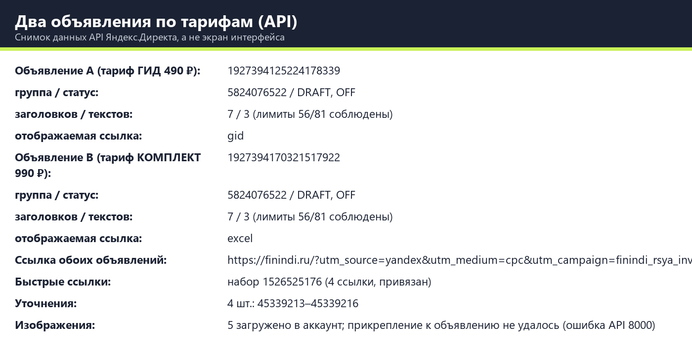
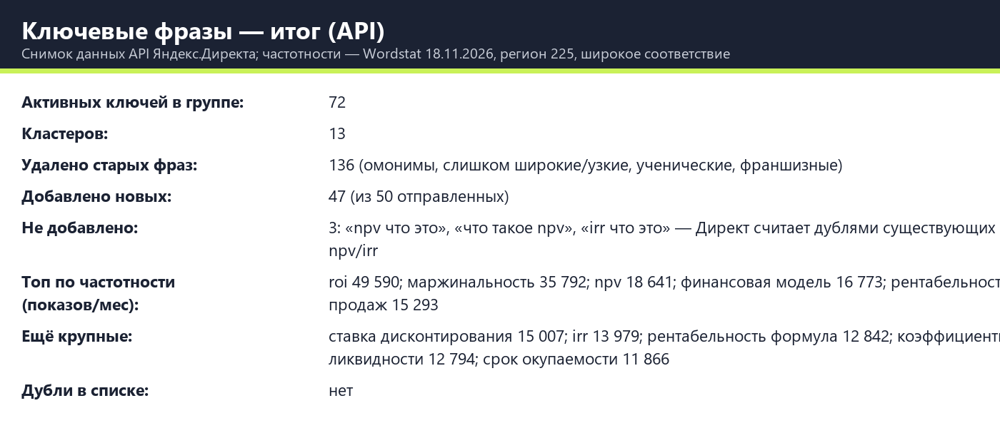
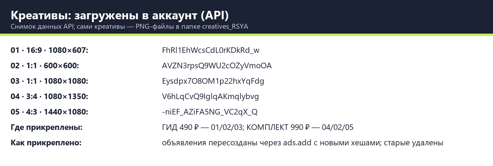
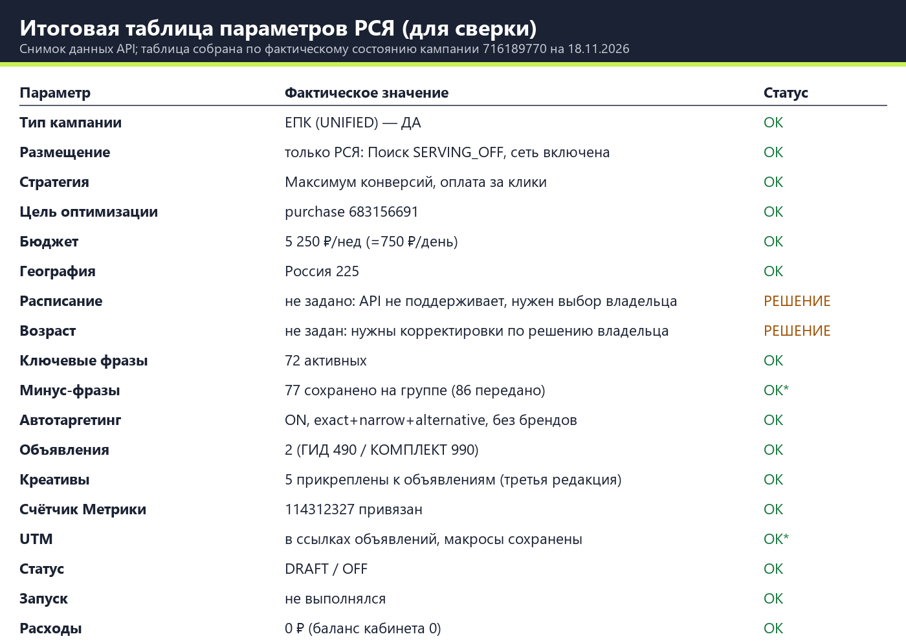

# Finindi — материалы подготовки РСЯ (Яндекс.Директ) + сопутствующий пакет VK Ads

Дата: **18.11.2026**. Кампания Яндекс.Директа **716189770** (`invest-guide-EPK-RSYa`) подготовлена и оставлена в **DRAFT / OFF**. Кампания **не запускалась**, модерация не отправлялась, расходов нет (баланс кабинета 0 ₽).

Это единая точка входа: отчёт, ключевые фразы (Excel), 5 креативов (третья редакция, прикреплены к объявлениям), 7 снимков данных API, сырые ответы API (evidence) и ранее подготовленный пакет VK Ads.

## Что открыть в первую очередь

| Материал | Файл |
|---|---|
| **Полный отчёт по подготовке РК (Markdown, 14 разделов + решения владельца)** | [ОТЧЁТ-РСЯ-716189770-2026-11-18.md](ОТЧЁТ-РСЯ-716189770-2026-11-18.md) |
| **Итоговая таблица параметров РСЯ (снимок)** | [screenshots/07_params_table.png](screenshots/07_params_table.png) |
| **Ключевые фразы — лист `Keywords`, 284 строки** | [keywords_RSYA.xlsx](keywords_RSYA.xlsx) |
| **Креативы (5 PNG + описание)** | [creatives_RSYA/](creatives_RSYA/) |
| **Сырые ответы API (доказательная база)** | [evidence_api/](evidence_api/) |
| **Пакет VK Ads (не проверялся в этой сессии)** | [related_vk_ads/](related_vk_ads/) |

## Ключевые факты

| Параметр | Значение |
|---|---|
| Кампания | 716189770, UNIFIED (ЕПК), **DRAFT / OFF**, показов 0 |
| Стратегия | **«Максимум конверсий с оплатой за клики»** (`WB_MAXIMUM_CONVERSION_RATE`) |
| Цель оптимизации | **`purchase` 683156691** (не заменялась на промежуточные) |
| Бюджет | недельный лимит **5 250 ₽** (эквивалент 750 ₽/день) |
| Размещение | только РСЯ: Поиск `SERVING_OFF`, сеть включена |
| География | Россия (регион 225) |
| Группа | 5824076522 «Инвестиционные показатели · ядро» |
| Объявления | 2: **ГИД 490 ₽** (1927394125224178339) и **КОМПЛЕКТ 990 ₽** (1927394170321517922) |
| Ключевых фраз | 72 (из 75 аудированных; 3 стали дублями после нормализации Директа) |
| Минус-фраз | 77 сохранено на группе (передано 86, нормализация Директа) |
| Автотаргетинг | ON: `exact + narrow + alternative`, бренды — без брендов |
| Счётчик Метрики | 114312327 привязан |
| Быстрые ссылки / уточнения | набор 1526525176 / 45339213, 45339214, 45340727, 45340728 |
| UTM | `utm_source=yandex&utm_medium=cpc&utm_campaign=finindi_rsya_invest&utm_content={ad_id}&utm_term={keyword}` — в ссылках объявлений |
| Креативы | 5 PNG третьей редакции **прикреплены к объявлениям** (хеши — в отчёте и на снимке 05) |

## Креативы: что исправлено по правкам владельца

Латиница — только в названиях показателей (NPV, IRR, ROI, PI, PP, DPP, MIRR, WACC, DSCR); «фининди» — только в логотипе; термины — «Гид», «Эксель-шаблон», «промпт-пак для нейросетей»; «ПДФ» — только формат файла (без «ПДФ-гид»); на 05 — «в отчётности цифры», не «проблемы»; «8 чисел» (02) — самый яркий, рекомендован основным.

| Файл | Хеш | Где стоит |
|---|---|---|
| 01 · 1080×607 | `FhRl1EhWcsCdL0rKDkRd_w` | ГИД 490 ₽ |
| 02 · 600×600 | `AVZN3rpsQ9WU2cOZyVmoOA` | оба объявления |
| 03 · 1080×1080 | `Eysdpx7O8OM1p22hxYqFdg` | ГИД 490 ₽ |
| 04 · 1080×1350 | `V6hLqCvQ9IglqAKmqlybvg` | КОМПЛЕКТ 990 ₽ |
| 05 · 1440×1080 | `-niEF_AZiFA5NG_VC2qX_Q` | КОМПЛЕКТ 990 ₽ |

Как прикреплено: `ads.update` в API v501 не принимает массив в `AdImageHashes` (ошибка 8000), поэтому оба объявления пересозданы через `ads.add` с новыми хешами, старые (с картинками прошлой редакции) удалены.

## Скриншоты (7) — это снимки данных API, а не экраны интерфейса Директа

Браузерной сессии в кабинете Директа нет, поэтому значения зафиксированы JSON-ответами API и отрендерены в PNG. Каждый файл подписан «Снимок данных API, а не экран интерфейса».









## Структура

```
ОТЧЁТ-РСЯ-716189770-2026-11-18.md   — полный отчёт
keywords_RSYA.xlsx                  — лист Keywords (75 ключей + 86 минусов + 123 теста = 284)
creatives_RSYA/                     — 5 PNG + 08_creatives.md/json + source_notes + README
screenshots/                        — 7 снимков данных API
evidence_api/                       — snapshots (до/после), raw_mcp_evidence (все ответы и ошибки API), audit_before.json, plan.json
related_vk_ads/                     — пакет VK Ads по Finindi (settings/audience/creative/verification), в этой сессии не проверялся
```

## Ограничения (важно для независимой проверки)

1. **UI-скриншоты Яндекс.Директа недоступны** — доступ только по API/MCP. Все значения подтверждены JSON-ответами в `evidence_api/raw_mcp_evidence/`.
2. **Креативы прикреплены к объявлениям пересозданием** — `ads.update` в API v501 не принимает массив в `AdImageHashes` (ошибка 8000), поэтому объявления созданы заново через `ads.add`; старые удалены. Кампания DRAFT/OFF, расходов нет.
3. **Кампанийные `TrackingParams` и кампанийные минус-фразы** через MCP-шлюз не сохраняются: UTM внесён в ссылки объявлений, все минусы перенесены на уровень группы.
4. **Расписание и возрастные корректировки не заданы** — требуют решения владельца (варианты и последствия — в отчёте, §6).
5. **Цель `purchase`** принята API как GoalId стратегии; фактическое срабатывание не проверено (нет публичного сайта, реальных оплат и интеграции Метрики в click.ru).
6. **Исходный `keywords.xlsx`** (лист `Keywords`, 284 строки) в рабочей папке отсутствовал — книга реконструирована из артефактов аудита (75 ключей + 86 минусов + 123 теста); требует подтверждения владельца.
7. **Бюджет:** 750 ₽ × 14 дней = 10 500 ₽ против согласованных 10 000 ₽ на канал — расхождение требует решения владельца.
