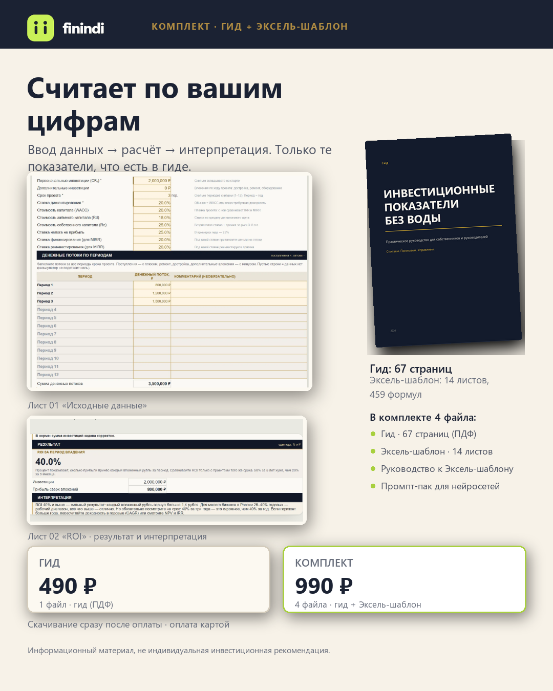
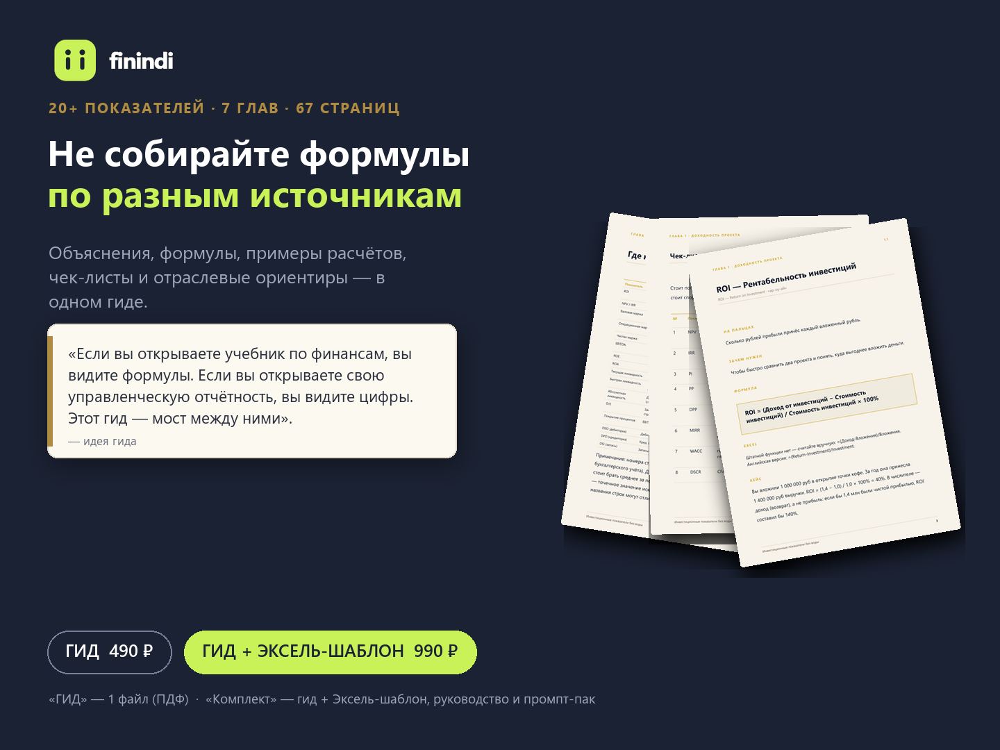

# Finindi — креативы для Яндекс.Директа (РСЯ)

Подготовлено и залито в кабинет 18.11.2026. Кампания 716189770 — **DRAFT/OFF, не запускалась, расходов 0 ₽**.

**Продукт**
- **ГИД — 490 ₽** — 1 файл ПДФ: гид «Инвестиционные показатели без воды», 67 страниц, 7 глав, 20+ показателей.
- **КОМПЛЕКТ — 990 ₽** — 4 файла: гид + Эксель-шаблон (14 листов, 459 формул) + руководство к Эксель-шаблону + промпт-пак для нейросетей.

**Терминология (по правкам владельца):** «Гид» — продукт, «ПДФ» — только формат файла (не «ПДФ-гид»); «Эксель-шаблон»; латиница — только в названиях показателей (NPV, IRR, ROI, PI, PP, DPP, MIRR, WACC, DSCR); «фининди» — только в логотипе.

**Посадочная:** https://finindi.ru/ · **Размещение:** РСЯ (сети), ЕПК.

## Изображения (5 шт., третья редакция)

| # | Файл | Формат | Идея | Хеш в Директе |
|---|---|---|---|---|
| 01 | [images/finindi_rsya_01_1080x607.png](images/finindi_rsya_01_1080x607.png) | 1080×607 (16:9) | «20+ инвестиционных показателей без воды»; обложка гида + страница с формулой ROI | `FhRl1EhWcsCdL0rKDkRd_w` |
| 02 | [images/finindi_rsya_02_600x600.png](images/finindi_rsya_02_600x600.png) | 600×600 (1:1) | «8 чисел вместо споров о проекте»; реальный чек-лист из гида (стр. 19) | `AVZN3rpsQ9WU2cOZyVmoOA` |
| 03 | [images/finindi_rsya_03_1080x1080.png](images/finindi_rsya_03_1080x1080.png) | 1080×1080 (1:1) | «Все основные формулы в одном месте»; рамки ФОРМУЛА ROI/NPV/IRR из файла ПДФ | `Eysdpx7O8OM1p22hxYqFdg` |
| 04 | [images/finindi_rsya_04_1080x1350.png](images/finindi_rsya_04_1080x1350.png) | 1080×1350 (3:4) | «Считает по вашим цифрам»; листы Эксель-шаблона + обложка гида | `V6hLqCvQ9IglqAKmqlybvg` |
| 05 | [images/finindi_rsya_05_1440x1080.png](images/finindi_rsya_05_1440x1080.png) | 1440×1080 (4:3) | «Не собирайте формулы по разным источникам»; страницы гида веером + идея из введения | `-niEF_AZiFA5NG_VC2qX_Q` |

Плашки с тарифами: на 01, 03, 05 — «ГИД 490 ₽» и «ГИД + Эксель-шаблон 990 ₽»; на 02 — «ГИД 490 ₽» / «КОМПЛЕКТ 990 ₽»; на 04 — карточки «ГИД 490 ₽» и «КОМПЛЕКТ 990 ₽».

## Заголовки (7 шт., лимит 56)

| # | Заголовок | Длина | Направление |
|---|---|---:|---|
| T1 | 20+ инвестиционных показателей без воды | 39 | A |
| T2 | Формулы, примеры и ориентиры в одном гиде | 41 | A |
| T3 | NPV, IRR, ROI — на пальцах, с примерами | 39 | A |
| T4 | Разберитесь в показателях инвестиционного проекта | 49 | B |
| T5 | Оцените инвестпроект по 8 показателям гида | 42 | B |
| T6 | Не собирайте финансовые формулы по разным источникам | 52 | B |
| T7 | Гид за 490 ₽ или гид + Эксель-шаблон за 990 ₽ | 45 | C |

## Тексты (3 шт., лимит 81)

| # | Текст | Длина | Направление |
|---|---|---:|---|
| X1 | 20+ показателей: объяснение, формула, пример, ориентир. Гид, 67 страниц (ПДФ). | 78 | A |
| X2 | Разберитесь, как оценить проект: чек-лист из 8 показателей в гиде. | 66 | B |
| X3 | ГИД — 490 ₽, 1 файл. Комплект с Эксель-шаблоном — 990 ₽, 4 файла. | 65 | C |

## Что стоит первым

**02 «8 чисел» + T5 + X2** — самый яркий и быстрее считывается: крупная лаймовая «8», реальный чек-лист со стр. 19, 1:1 хорошо работает на мобильных. Второй — **01 + T1 + X1** (широкий формат), третий — **04 + T7 + X3** (тарифы), четвёртый — **03 + T3 + X1** (формулы).

## Где прикреплено

- **1927394125224178339** — «ГИД 490 ₽», отображаемая ссылка `gid`: картинки 01, 02, 03.
- **1927394170321517922** — «КОМПЛЕКТ 990 ₽», отображаемая ссылка `komplekt`: картинки 04, 02, 05.

`ads.update` в API v501 не принимает массив в `AdImageHashes` (ошибка 8000), поэтому объявления пересозданы через `ads.add` с новыми хешами; старые объявления с картинками прошлой редакции удалены.

## Из каких материалов собрано

Только реальные материалы продукта:
- рендеры страниц файла ПДФ (220 dpi): обложка, стр. 3 (ROI), стр. 5 (NPV), стр. 7 (IRR), стр. 19 (чек-лист), стр. 51, стр. 60 (глоссарий);
- рамки ФОРМУЛА в 03 вырезаны из рендера страниц, не перепечатаны;
- скриншоты листов Эксель-шаблона;
- настоящий логотип.

Стоковых фотографий, рукопожатий, абстрактных графиков роста и изображений денег нет. Обещаний доходности и искусственной срочности нет.

## Файлы

- `08_creatives.md` — концепции, обоснование, модерация, размещение в Директе
- `08_creatives.json` — машиночитаемый набор: `titles[7]`, `texts[3]`, `images[5]`, `direct`
- `source_notes.md` — откуда взяты фрагменты
- `images/` — 5 PNG

---

Подготовлено в рамках задачи «Finindi — подготовка РК в Яндекс.Директе (только РСЯ)». Кампания не запускалась, бюджет не расходовался.
